# Database Architecture & Entity Relationships — Modern Retail POS

## 1. Architectural Philosophy & Engine Configuration

The database architecture is designed specifically for **local-first, enterprise offline retail operations** in SQLite, with complete structural and relational compatibility for multi-counter local networks and centralized multi-branch PostgreSQL synchronization.
Data consistency, auditability, multi-tenant isolation, and historical non-repudiation are enforced at the database engine level:

- **Engine Mode**: `PRAGMA journal_mode = WAL;` (Write-Ahead Logging for high-performance concurrent reading without write-blocking).
- **Relational Integrity**: `PRAGMA foreign_keys = ON;` (Strict constraint checking; cascading deletes are prohibited on posted financial documents).
- **Durability Pragmas**: `PRAGMA synchronous = NORMAL;`, `PRAGMA busy_timeout = 5000;`.
- **Primary Keys**: Universally Unique Identifiers (UUID v4 format stored as `TEXT` in SQLite / native `UUID` in PostgreSQL).
- **Multi-Tenant & Multi-Branch Hierarchy**: Root `businesses` table (`business_id`), child `branches` (`branch_id`), and store terminal `counters`.
- **Composite Referential Integrity**: Composite foreign keys prevent cross-tenant cross-wiring (e.g., counters cannot reference a branch from a different business; users cannot be granted roles belonging to a foreign business).
- **Monetary Convention**: Currency columns end with `_minor` and store integer minor currency units (paisa/cents). Authoritative financial calculations never use floating-point numbers.
- **Physical Quantities**: Quantity columns end with `_scaled` and utilize precision scale factors (`QUANTITY_SCALE = 10,000`).
- **Historical Snapshot Preservation**: Posted bills snapshot product names, SKUs, tax rates, bill discounts, and unit costs at the moment of posting. Master catalog modifications never alter historical financial records.
- **Append-Only Immutability**: Critical security logs (`audit_logs`) are protected by SQLite triggers that abort any `DELETE` or `UPDATE` operation.

---

## 2. Complete Entity-Relationship Model

```mermaid
erDiagram
    businesses ||--o{ branches : "owns"
    businesses ||--o{ business_settings : "configures"
    businesses ||--o{ business_modules : "activates"
    businesses ||--o{ users : "employs"
    businesses ||--o{ roles : "defines"
    businesses ||--o{ audit_logs : "records"

    branches ||--o{ counters : "deploys"
    branches ||--o{ user_branch_access : "assigns"
    branches ||--o{ stock_movements : "located at"
    branches ||--o{ stock_balances : "balance at"

    users ||--o{ user_roles : "assigned"
    roles ||--o{ user_roles : "grants"
    roles ||--o{ role_permissions : "includes"
    permissions ||--o{ role_permissions : "granted to"
    users ||--o{ audit_logs : "triggers"
    users ||--o{ sales : "creates"
    users ||--o{ cash_sessions : "opens/closes"

    module_definitions ||--o{ business_modules : "instantiates"

    categories ||--o{ categories : "parent of"
    categories ||--o{ products : "categorizes"
    brands ||--o{ products : "manufactures"
    units ||--o{ products : "base unit of"
    units ||--o{ product_unit_conversions : "converts to"
    units ||--o{ product_barcodes : "barcoded as"
    products ||--o{ product_variants : "has variant"
    products ||--o{ product_barcodes : "scannable by"
    products ||--o{ product_unit_conversions : "has packaging"
    products ||--o{ product_prices : "priced at"
    products ||--o{ product_batches : "batched in"
    products ||--o{ product_serial_numbers : "serialized with"

    stock_movements ||--|| stock_balances : "projects to"

    customers ||--o{ customer_ledger_entries : "account statement"
    customers ||--o{ sales : "purchases"
    suppliers ||--o{ supplier_ledger_entries : "account statement"
    suppliers ||--o{ purchases : "supplies"
    companies ||--o{ warranty_cases : "repairs"

    sales ||--o{ sale_lines : "contains"
    purchases ||--o{ purchase_lines : "contains"
    sales ||--o{ sale_returns : "returned via"
    purchases ||--o{ supplier_returns : "returned to vendor"

    payment_methods ||--o{ payments : "settled through"
    payments ||--o{ payment_allocations : "allocated across"
    cash_sessions ||--o{ cash_movements : "tracks drawer cash"
    payments ||--o{ cash_movements : "generates drawer cash"

    expense_categories ||--o{ expenses : "classifies"
    employees ||--o{ salary_entries : "accrues"
    salary_entries ||--o{ salary_payments : "disburses"

    warranty_cases ||--o{ warranty_movements : "lifecycle events"
```

---

## 3. Logical Table Groups & Detailed Column Definitions

### GROUP A: Universal Enterprise Multi-Tenancy & Security
| Table | Columns | Purpose & Invariants |
|---|---|---|
| `businesses` | `id` (UUID PK), `name`, `legal_name`, `business_type`, `registration_number`, `phone`, `email`, `address`, `default_currency`, `timezone`, `is_active`, `created_at`, `updated_at` | Root enterprise tenant profile; defines currency and timezone boundaries |
| `branches` | `id` (UUID PK), `business_id` (FK), `name`, `code`, `address`, `phone`, `is_active`, `created_at`, `updated_at`, `UNIQUE(business_id, code)`, `UNIQUE(id, business_id)` | Physical retail store branches; unique code per business |
| `counters` | `id` (UUID PK), `business_id` (FK), `branch_id` (FK), `name`, `code`, `device_identifier`, `is_active`, `created_at`, `updated_at`, `UNIQUE(branch_id, code)`, `FOREIGN KEY (branch_id, business_id) REFERENCES branches(id, business_id)` | Checkout register / terminal; composite foreign key guarantees counter cannot reference another business's branch |
| `users` | `id` (UUID PK), `business_id` (FK), `username`, `password_hash`, `full_name`, `email`, `phone`, `is_active`, `last_login_at`, `created_at`, `updated_at`, `UNIQUE(business_id, username)`, `UNIQUE(id, business_id)` | System operators; passwords strictly bcrypt hashed; duplicate usernames allowed across distinct businesses but strictly forbidden within the same business |
| `roles` | `id` (UUID PK), `business_id` (FK), `name`, `description`, `is_system_role`, `created_at`, `updated_at`, `UNIQUE(business_id, name)`, `UNIQUE(id, business_id)` | Authorization roles scoped per business; system roles protected |
| `permissions` | `id` (UUID PK), `code` (UNIQUE), `module`, `description` | Fine-grained capability definitions (e.g. `sales:create`, `sales:void`, `inventory:adjust`) |
| `role_permissions` | `role_id` (FK), `permission_id` (FK), `PRIMARY KEY (role_id, permission_id)` | Role-to-permission mapping with cascading deletes on custom roles |
| `user_roles` | `user_id` (FK), `role_id` (FK), `business_id` (FK), `PRIMARY KEY (user_id, role_id)`, `FOREIGN KEY (user_id, business_id) REFERENCES users(id, business_id)`, `FOREIGN KEY (role_id, business_id) REFERENCES roles(id, business_id)` | User-to-role assignment; composite foreign keys strictly prevent cross-business role granting |
| `user_branch_access` | `user_id` (FK), `branch_id` (FK), `PRIMARY KEY (user_id, branch_id)` | Multi-branch access permissions for mobile store managers and cashiers |
| `business_settings` | `id` (UUID PK), `business_id` (FK), `setting_key`, `setting_value` (JSON), `updated_by` (FK), `updated_at`, `UNIQUE(business_id, setting_key)` | Scoped key-value configuration store with JSON payloads |
| `module_definitions` | `id` (UUID PK), `module_code` (UNIQUE), `module_name`, `description`, `is_core`, `dependencies` (JSON), `created_at` | Global catalog of business modules (Core, Weighing Scale, Batch Expiry, Variant Matrix, Serial/Warranty, Branch Sync) |
| `business_modules` | `id` (UUID PK), `business_id` (FK), `module_id` (FK), `is_enabled`, `configuration` (JSON), `enabled_at`, `disabled_at`, `updated_by` (FK), `updated_at`, `UNIQUE(business_id, module_id)` | Activation and configuration of optional vertical features per business |
| `audit_logs` | `id` (UUID PK), `business_id` (FK), `branch_id` (FK), `user_id` (FK), `action`, `entity_type`, `entity_id`, `before_data` (JSON), `after_data` (JSON), `reason`, `ip_address`, `device_identifier`, `created_at` | Append-only tamper-proof audit trail; protected by `trg_audit_logs_no_delete` and `trg_audit_logs_no_update` triggers |
| `document_sequences` | `id`, `document_type` (UNIQUE), `prefix`, `next_number` | Atomic sequence generator (INV, PO, PAY, ADJ, SRN, PRN, WAR, EXP) |
| `schema_migrations` | `version` (PK), `name`, `applied_at` | Version history of sequential database schema migrations |

---

### GROUP B: Categories, Products, Variants & Units
| Table | Columns | Purpose & Invariants |
|---|---|---|
| `categories` | `id`, `parent_id` (FK self-referential), `name`, `is_active` | Hierarchical product taxonomy with unlimited subcategories |
| `brands` | `id`, `name` (UNIQUE), `is_active` | Manufacturers and trade brands |
| `units` | `id`, `name` (UNIQUE), `symbol`, `dimension` (COUNT, WEIGHT, VOLUME, LENGTH), `precision_scale` | Standard units: Piece (scale 0), Dozen (scale 0), Pack (scale 0), Kg (scale 3), Litre (scale 3) |
| `products` | `id`, `sku` (UNIQUE), `name`, `category_id` (FK), `brand_id` (FK), `base_unit_id` (FK), `default_cost_minor`, `default_sale_price_minor`, `reorder_level_scaled`, `tracking_mode` (STANDARD, BATCH, SERIAL), `tax_rate`, `is_tax_inclusive`, `is_active`, `created_at` | Master catalog record |
| `product_variants` | `id`, `product_id` (FK), `variant_sku` (UNIQUE), `size`, `color`, `model`, `cost_minor`, `price_minor`, `is_active` | Garments, shoes, models, and variant SKUs |
| `product_barcodes` | `id`, `product_id` (FK), `variant_id` (FK), `barcode` (UNIQUE), `unit_id` (FK) | Multiple barcodes per product, variant, or packaging unit |
| `product_unit_conversions` | `id`, `product_id` (FK), `unit_id` (FK), `base_units_numerator`, `base_units_denominator`, `UNIQUE(product_id, unit_id)` | Product-specific packaging conversions (e.g. Shampoo pack = 6 pcs, Juice pack = 12 pcs) |
| `product_prices` | `id`, `product_id` (FK), `variant_id` (FK), `unit_id` (FK), `price_type` (RETAIL, WHOLESALE, SPECIAL), `price_minor`, `UNIQUE(product_id, variant_id, unit_id, price_type)` | Tiered pricing per customer type or packaging unit |
| `product_batches` | `id`, `product_id` (FK), `batch_number`, `expiry_date`, `cost_minor`, `created_at`, `UNIQUE(product_id, batch_number)` | FIFO batch cost tracking and perishable expiry alerts |
| `product_serial_numbers` | `id`, `product_id` (FK), `variant_id` (FK), `serial_number` (UNIQUE), `status` (IN_STOCK, SOLD, DEFECTIVE, RETURNED_TO_SUPPLIER, UNDER_WARRANTY) | Electronic serialization and IMEI tracking |

---

### GROUP C: Inventory & Stock Ledger
| Table | Columns | Purpose & Invariants |
|---|---|---|
| `locations` | `id`, `name` (UNIQUE), `is_active` | Physical stores, warehouses, or storage rooms |
| `registers` | `id`, `location_id` (FK), `name`, `is_active`, `UNIQUE(location_id, name)` | Specific cash counters and checkout terminals |
| `stock_movements` | `id`, `product_id` (FK), `variant_id` (FK), `location_id` (FK), `batch_id` (FK), `serial_id` (FK), `movement_type`, `quantity_base_scaled`, `previous_stock`, `new_stock`, `source_type`, `source_id`, `reason`, `user_id` (FK), `created_at` | Immutable, permanent inventory ledger |
| `stock_balances` | `product_id` (FK), `variant_id`, `location_id` (FK), `batch_id`, `quantity_base_scaled`, `PRIMARY KEY (product_id, variant_id, location_id, batch_id)` | Transactional projection table; never directly edited without a stock movement entry |
| `stock_adjustments` | `id`, `adjustment_number` (UNIQUE), `location_id` (FK), `reason`, `status` (DRAFT, APPROVED, CANCELLED), `created_by` (FK), `approved_by` (FK), `created_at`, `approved_at` | Stock audit header |
| `stock_adjustment_lines` | `id`, `adjustment_id` (FK), `product_id` (FK), `variant_id` (FK), `system_qty_scaled`, `counted_qty_scaled`, `difference_qty_scaled` | Physical count vs system count discrepancy lines |

---

### GROUP D: Customers, Suppliers & Companies
| Table | Columns | Purpose & Invariants |
|---|---|---|
| `customers` | `id`, `customer_code` (UNIQUE), `name`, `phone` (UNIQUE), `address`, `credit_limit_minor`, `balance`, `is_active`, `created_at` | Customer directory; balance is cached and strictly reconciled against ledger |
| `suppliers` | `id`, `supplier_code` (UNIQUE), `name` (UNIQUE), `contact_person`, `phone`, `address`, `balance`, `is_active`, `created_at` | Supplier accounts payable records |
| `companies` | `id`, `name` (UNIQUE), `company_type` (MANUFACTURER, DISTRIBUTOR, WARRANTY_PROVIDER), `phone`, `address`, `is_active` | Manufacturers, distributors, and repair centers |
| `customer_ledger_entries` | `id`, `customer_id` (FK), `entry_type` (OPENING_BALANCE, SALE_INVOICE, PAYMENT_RECEIVED, SALE_RETURN, ADJUSTMENT), `debit_minor`, `credit_minor`, `source_type`, `source_id`, `notes`, `created_at` | Authoritative customer account statement; $\text{Balance} = \sum \text{Debits} - \sum \text{Credits}$ |
| `supplier_ledger_entries` | `id`, `supplier_id` (FK), `entry_type` (OPENING_BALANCE, PURCHASE_BILL, PAYMENT_DISBURSED, PURCHASE_RETURN, ADJUSTMENT), `debit_minor`, `credit_minor`, `source_type`, `source_id`, `notes`, `created_at` | Authoritative vendor account statement; $\text{Balance} = \sum \text{Credits} - \sum \text{Debits}$ |

---

### GROUP E: Sales, Purchases & Returns
| Table | Columns | Purpose & Invariants |
|---|---|---|
| `sales` | `id`, `invoice_number` (UNIQUE), `customer_id` (FK), `location_id` (FK), `register_id` (FK), `status` (DRAFT, POSTED, REFUNDED, VOIDED), `subtotal_minor`, `discount_minor`, `tax_minor`, `total_minor`, `total_cost_minor`, `profit_minor`, `payment_method`, `amount_paid`, `change_given`, `customer_balance_change`, `created_by` (FK), `created_at` | Sale transaction header |
| `sale_lines` | `id`, `sale_id` (FK RESTRICT), `product_id` (FK RESTRICT), `variant_id` (FK), `product_name_snapshot`, `sku_snapshot`, `unit_id` (FK), `quantity_scaled`, `unit_price_minor`, `discount_minor`, `tax_minor`, `unit_cost_minor`, `line_total_minor` | Historical snapshot line items (product name, SKU, price, and cost are frozen) |
| `purchases` | `id`, `purchase_number` (UNIQUE), `supplier_id` (FK RESTRICT), `supplier_invoice_number`, `location_id` (FK), `status` (DRAFT, POSTED, CANCELLED), `subtotal_minor`, `additional_cost_minor`, `total_minor`, `created_by` (FK), `created_at` | Supplier purchase order bill |
| `purchase_lines` | `id`, `purchase_id` (FK RESTRICT), `product_id` (FK RESTRICT), `variant_id` (FK), `unit_id` (FK), `quantity_scaled`, `unit_cost_minor`, `discount_minor`, `tax_minor`, `line_total_minor` | Purchase order detail lines |
| `sale_returns` | `id`, `return_number` (UNIQUE), `original_sale_id` (FK RESTRICT), `customer_id` (FK), `location_id` (FK), `reason`, `status`, `refund_minor`, `created_by` (FK), `created_at` | Customer returns header |
| `sale_return_lines` | `id`, `sale_return_id` (FK RESTRICT), `original_sale_line_id` (FK RESTRICT), `product_id` (FK), `variant_id` (FK), `quantity_scaled`, `disposition` (RETURN_TO_STOCK, DAMAGED_WRITE_OFF, WARRANTY_REPAIR), `refund_minor` | Return lines and item condition disposition |
| `supplier_returns` | `id`, `return_number` (UNIQUE), `supplier_id` (FK RESTRICT), `original_purchase_id` (FK RESTRICT), `location_id` (FK), `status`, `reason`, `created_by` (FK), `created_at` | Vendor returns header |
| `supplier_return_lines` | `id`, `supplier_return_id` (FK RESTRICT), `product_id` (FK), `variant_id` (FK), `quantity_scaled`, `cost_minor` | Vendor return items |

---

### GROUP F: Payments & Payment Allocations
| Table | Columns | Purpose & Invariants |
|---|---|---|
| `payment_methods` | `id`, `name` (UNIQUE), `method_type` (CASH, BANK, DIGITAL_WALLET, OTHER), `affects_cash_drawer` (0, 1), `is_active` | Configures whether method affects physical cash drawer |
| `cash_sessions` | `id`, `register_id` (FK), `opened_by` (FK), `opening_cash_minor`, `closed_by` (FK), `expected_cash_minor`, `counted_cash_minor`, `difference_minor`, `status` (OPEN, CLOSED), `opened_at`, `closed_at` | Register opening float and closing cash reconciliation |
| `payments` | `id`, `payment_number` (UNIQUE), `party_type` (CUSTOMER, SUPPLIER, OTHER), `party_id`, `direction` (INBOUND, OUTBOUND), `amount_minor`, `payment_method_id` (FK), `cash_session_id` (FK), `status`, `notes`, `created_by` (FK), `created_at` | Actual financial receipt or disbursement |
| `payment_allocations` | `id`, `payment_id` (FK RESTRICT), `document_type` (SALE, PURCHASE, SALE_RETURN, SUPPLIER_RETURN, ADVANCE), `document_id`, `amount_minor`, `created_at` | Allocates a payment across one or multiple bills or customer advance |
| `cash_movements` | `id`, `cash_session_id` (FK), `movement_type` (OPENING_FLOAT, CASH_SALE, CASH_SALE_REFUND, CUSTOMER_PAYMENT, SUPPLIER_PAYMENT, EXPENSE_PAYOUT, CASH_IN, CASH_OUT), `amount_minor`, `direction` (IN, OUT), `source_type`, `source_id`, `notes`, `created_at` | Detailed cash drawer inflow/outflow audit log |

---

### GROUP G: Expenses, Employees & Salaries
| Table | Columns | Purpose & Invariants |
|---|---|---|
| `expense_categories` | `id`, `name` (UNIQUE), `is_active` | Overhead categories (Rent, Utilities, Transport, Cleaning) |
| `expenses` | `id`, `expense_number` (UNIQUE), `category_id` (FK), `amount_minor`, `payment_method_id` (FK), `cash_session_id` (FK), `description`, `status` (PAID, VOIDED), `created_by` (FK), `created_at` | Operating expense records |
| `employees` | `id`, `employee_code` (UNIQUE), `name`, `phone`, `joining_date`, `base_salary_minor`, `is_active` | Staff directory and monthly compensation baseline |
| `salary_entries` | `id`, `employee_id` (FK), `period_start`, `period_end`, `gross_minor`, `deductions_minor`, `net_minor`, `status` (CALCULATED, PARTIALLY_PAID, PAID), `created_at`, `UNIQUE(employee_id, period_start, period_end)` | Salary liability obligation |
| `salary_payments` | `id`, `salary_entry_id` (FK), `amount_minor`, `payment_method_id` (FK), `payment_date` | Actual salary disbursements (allows partial pay) |

---

### GROUP H: Warranty & Repaired Items
| Table | Columns | Purpose & Invariants |
|---|---|---|
| `warranty_cases` | `id`, `case_number` (UNIQUE), `product_id` (FK), `variant_id` (FK), `serial_id` (FK), `supplier_id` (FK), `company_id` (FK), `customer_id` (FK), `issue_description`, `status` (RECEIVED, DISPATCHED_TO_COMPANY, RETURNED_FROM_COMPANY, DELIVERED_TO_CUSTOMER, REJECTED), `created_at` | RMA / warranty service tracking |
| `warranty_movements` | `id`, `warranty_case_id` (FK), `movement_type` (INTAKE, DISPATCH, REPAIR_RECEIPT, CUSTOMER_DELIVERY, SCRAPPED), `quantity_scaled`, `serial_id` (FK), `source_document_id`, `notes`, `created_at` | Complete chronological lifecycle of the repair item |

---

### GROUP I: Backup & Idempotency Operation History
| Table | Columns | Purpose & Invariants |
|---|---|---|
| `backup_history` | `id`, `backup_path`, `checksum`, `status` (SUCCESS, FAILED), `size_bytes`, `verification_result`, `created_at` | Local snapshot history and integrity checksums |
| `idempotency_keys` | `key` (PK), `operation_type`, `response_payload`, `created_at` | Prevents double-clicking or duplicate submission of financial transactions |

---

## 4. Key Database Invariant Rules

1. **Enterprise Multi-Tenant Isolation**:
   - Every store entity has an authoritative `business_id` scoping.
   - **Counter to Branch Isolation**: Counters cannot be linked to a branch that belongs to another business. Enforced via composite constraint: `FOREIGN KEY (branch_id, business_id) REFERENCES branches(id, business_id)`.
   - **Username Uniqueness Scoping**: Usernames are unique within a business (`UNIQUE(business_id, username)`). Two independent businesses can have a user `admin` or `cashier1` without conflict.
   - **Role Assignment Isolation**: Users cannot be assigned roles from a different business. Enforced by composite foreign keys on `user_roles`: `FOREIGN KEY (user_id, business_id) REFERENCES users(id, business_id)` and `FOREIGN KEY (role_id, business_id) REFERENCES roles(id, business_id)`.
   - **Unique Business Modules**: A business cannot activate duplicate module entries: `UNIQUE(business_id, module_id)`.
2. **Immutable Audit Trail**:
   - `audit_logs` records cannot be updated or deleted under any circumstances.
   - Guarded by SQLite triggers: `trg_audit_logs_no_delete` and `trg_audit_logs_no_update`, which invoke `SELECT RAISE(ABORT, ...)`.
3. **No Cascading Deletion of Posted Financial Records**:
   `sales`, `sale_lines`, `purchases`, `purchase_lines`, `payments`, `payment_allocations`, `customer_ledger_entries`, and `supplier_ledger_entries` use `ON DELETE RESTRICT`. A customer, supplier, or product with posted records cannot be deleted.
4. **Movements Authorize Balances**:
   `stock_balances` is never adjusted directly in isolation. Every stock adjustment writes an immutable record to `stock_movements`, which in turn updates `stock_balances`.
5. **Single Payment, Multiple Allocations**:
   One `payments` record maps to multiple `payment_allocations`. An advance is managed as an allocation to `ADVANCE` until applied to a future bill.
6. **Physical Cash Drawer Isolation**:
   Only payment methods with `affects_cash_drawer = 1` generate entries in `cash_movements`. Bank transfers, cheques, and digital wallets do not inflate drawer cash.
7. **Historical Snapshots**:
   `sale_lines.product_name_snapshot`, `sku_snapshot`, `unit_price_minor`, and `unit_cost_minor` guarantee that retroactive catalog price increases or rebranding never alter previously posted invoices.
